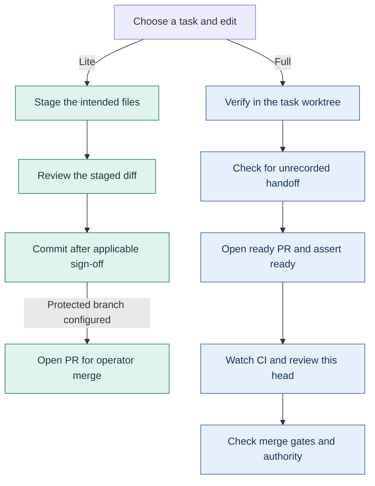
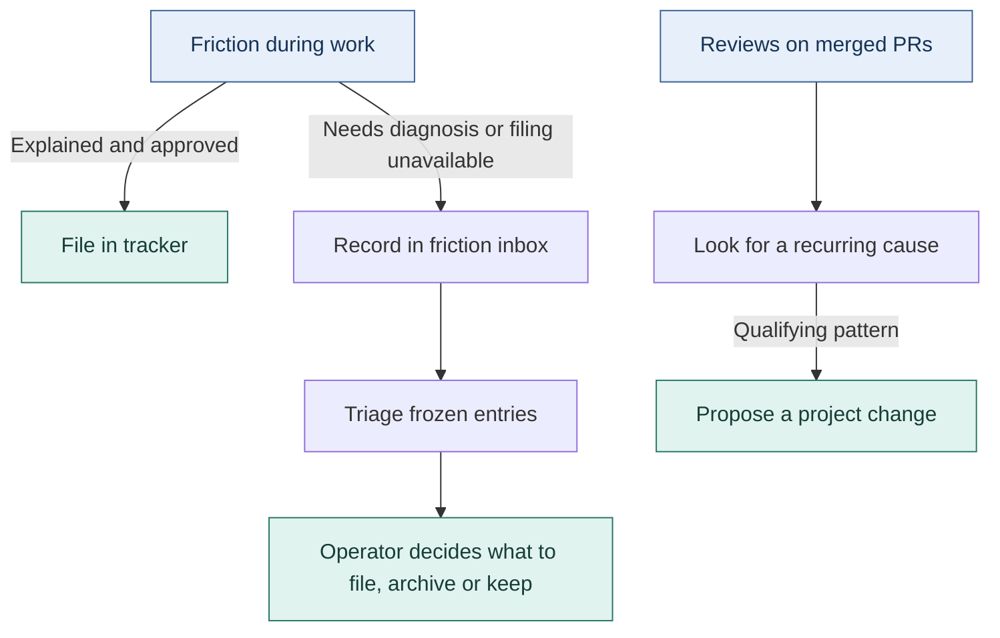

# agentic-dev-kit

Give a fresh coding-agent session enough context to pick up where you left off,
review its change, and hand the next decision back to you. The kit keeps that
context in your Git repository. Claude Code and Codex enter the same workflow
through their own skills. You own the installed files and choose when to upgrade.

> **A personal note.** I built this for my own development work with AI coding agents.
> The principles and choices here reflect my own preferences and workflows — not a
> universal best practice. Take what's useful, change what isn't, and shape it to fit
> how you like to work.

## Quickstart

| Where are you starting? | First action |
| --- | --- |
| A new project that wants the full kit | Use **Use this template** on GitHub, clone **your new repository**, then follow [Initialize a new project](#initialize-a-new-project). |
| A project with its own Git history, files or agent instructions | Start the [selective adoption workflow](docs/agentic-dev-kit/workflows/adopt.md) in that project. Choose Lite or Full and review its proposed file changes. |
| A project with an installed kit | Follow [Upgrading an already-adopted repo](#upgrading-an-already-adopted-repo). The installed profile determines the upgrade procedure. |
| A project already set up for work | Start a session in your client. The [first-session walkthrough](docs/getting-started.md) follows a change through review and handoff. |

### Choose an install profile

Choose the profile by **where you want review to happen** and which systems the
agent needs to read. Both profiles support a project that uses pull requests.

| | Lite | Full |
| --- | --- | --- |
| Starting a session | Read the plan, friction inbox, Git state and optional local story backlog. | Bring the plan and inbox together with PR reviews, CI and the configured tracker. |
| Reviewing the change | Review the staged diff before commit. When the configured risk tier applies, get a fresh-context review and operator approval. | Verify the branch and watch the PR. Independent review covers its current head, with an isolated lens or panel by default and an optional external review bot. |
| Delivering it | Commit locally. With a protected branch configured, open a PR for the operator to merge. | Open completed work ready for review. Use the PR's checks, review evidence and project merge policy to decide who can merge. |
| Installed in your project | Workflow Markdown and skill bindings, project configuration, the plan and the inbox. Install and upgrade checks use the doctor in the *kit clone*. | Selected workflow docs, bindings, engines and hooks. Full also supports parallel lanes and recurring triage. |

See the procedures for [choosing a profile](docs/agentic-dev-kit/workflows/adopt.md#choose-the-profile), [Lite review](docs/agentic-dev-kit/lite/lite-review.md) and [Full PR review](docs/agentic-dev-kit/workflows/pr-watch.md).

### Initialize a new project

In the **new full-template checkout**, open `config/dev-model.yaml` before running
the installer. The template is also the kit's development repository. In `paths`,
point `handoff`, `handoff_history`, `friction_log` and `friction_log_archive` at
your project's records. To use the shipped skeletons, choose `docs/handoff.md`,
`docs/handoff-history.md`, `docs/friction-log.md` and `docs/friction-log-archive.md`.
Use the same file and archive names in the matching `doc_budgets` entries.
Set `tracker.project_name` and `tracker.url` to your project, or clear both
and select the `none` backend if you have no tracker. The installer uses existing
values as prompt defaults. These settings determine which work and issue board
the first briefing sees.

From the root of that checkout, run:

```sh
./init.sh
```

The installer uses POSIX `sh`, Git and standard shell utilities. It prompts for
project and integration settings, renders the entry points and unclaimed records,
and reports hook installation. Check its output for skipped files and deferred
shared hooks. For the Full engines, install `uv` to run scripts with their declared
dependencies. Use Git 2.44 or later for the review helpers and authenticate `gh`
for the GitHub PR and lane commands. The Lite workflows need Git and your agent.
Lite installation and upgrades also use `uv` on the machine running the doctor.

Check the protected branch, tracker, reviewer settings and `review.safety_critical_paths`
against your project. The shipped path list describes this kit. Add your own
release, send, destructive-operation and recovery gates so they receive the
appropriate review. In the rendered `AGENTS.md`, fill in the project's verification
command. The installer prints the session-start invocation for your runtime.

### Agent runtime adapters

| In your agent session | Claude Code | Codex |
| --- | --- | --- |
| Ask for the next task | `/session-start` | `$session-start` |
| Review work before a Lite commit | `/review` | `$review` |
| Watch a PR on Full (example PR 42) | `/pr-watch 42` | `$pr-watch 42` |
| Hand over work | `/wrap-up` | `$wrap-up` |

Type these workflow names in the agent. For staged Lite review, invoke `wrap-up`; it calls `review` on the index. A standalone `review` reads the working change. Run commands such as `git status` and
`uv run scripts/kit_doctor.py` in a shell. Full shell examples use this kit's
`scripts` directory. In an adopted repo, read its location from `paths.engines`.
The [runtime parity inventory](docs/agentic-dev-kit/runtime-parity.md) lists the bindings and their capabilities.

## How it fits together

### Deliver a change



On Lite, `wrap-up` includes record edits in the staged review. A direct-commit
project can finish at the commit. On Full, run the handoff test *before* the
opening review. If a decision belongs in the handoff, include it on the branch
and verify the final change. The reviewer and CI then see the same revision.
An isolated lane reports its handoff to the coordinating session. The
[worked example](docs/getting-started.md) and [architecture diagrams](docs/architecture.md) follow these paths in detail.

### Turn experience into improvements



For example, a setup command that fails on a fresh checkout belongs in the inbox
while the cause is unknown. Once you have a reproduction, a mechanism and a
proposed fix, the workflow can present the ticket for approval. Separately, if
reviews on different merged PRs repeatedly catch the same mistake, the project
can change how the operation works or add a check that catches it. The
[triage](docs/agentic-dev-kit/workflows/triage-friction-log.md) and
[post-merge systemize](docs/agentic-dev-kit/workflows/post-merge-systemize.md) workflows define the decisions and evidence for each route.

## Adopting into an existing repo

From the target repository, ask your agent to follow the kit's
[adopt workflow](docs/agentic-dev-kit/workflows/adopt.md). If the adoption skill
is already available, invoke `/adopt` in Claude Code or `$adopt` in Codex.
Otherwise give the agent the workflow document from the kit and identify the
target checkout. The workflow fetches its source separately, inspects the target,
and asks which files to install, keep or point at before changing project files.

Bring an existing plan and agent instructions into that decision. For example,
`paths.handoff` can point at a project's existing roadmap, and `paths.engines` on
Full can point at `scripts/devkit`. The Full procedure gives the operator the
interactive installer step with `--no-clobber`; Lite records and checks its
selected bindings from the kit clone. The [ownership guide](docs/ownership.md)
explains how these choices affect the next upgrade.

## Upgrading an already-adopted repo

Start with the [upgrade workflow](docs/agentic-dev-kit/workflows/upgrade.md).
With no `config/dev-model.yaml`, it routes to adoption. With `profile: lite`, it
uses the fetched kit's doctor to preview the upgrade, settle locally edited or
kept files, and verify the approved result. A Full upgrade inspects the installed
files before refreshing the installer or replacing any engine.

### Which files actually drifted — `kit_doctor`

For a Full installation using the default engine path, run this from its root:

```sh
uv run scripts/kit_doctor.py
```

The doctor compares the installed bytes, the comparison manifest and the
installation baseline when available. Read the result before choosing a replacement.

| Report | What it tells you |
| --- | --- |
| `unchanged` / `stale` | The file matches the comparison manifest, or still matches the recorded install while the kit has changed. |
| `locally-edited` / `stale-and-edited` | Local bytes changed after installation. In the latter case the kit changed too. Inspect the differences before taking a new copy. |
| `differs` | The bytes differ and the available baseline cannot establish why. |
| `declined` / `new-upstream` / `outside-profile` | Check what was deliberately omitted, what the baseline never mentioned, and what belongs to a different profile. |
| `removed` / `missing-required` | A recorded file disappeared, or an installed component needs a missing file. Inspect the named path and dependency. |

Use the [upgrade inspection](docs/agentic-dev-kit/workflows/upgrade.md#step-1--diff-the-installation-read-only)
for the full report and [Lite upgrade](docs/agentic-dev-kit/workflows/upgrade.md#lite-profile)
for the checkout, baseline and branch arguments that path requires. Read
[changelog fragments](changelog.d/) alongside the frozen [changelog](CHANGELOG.md)
to see which behavior and configuration changes affect your installation.

## What's inside

| What you want to do | Read |
| --- | --- |
| Understand the design decisions | [Principles](PRINCIPLES.md) |
| Work through a change from briefing to handoff | [Getting started](docs/getting-started.md) |
| Find a command, interpret a review report or retire session scratch | [Developer guide](docs/developer-guide.md) |
| Trace a workflow from the agent to its engine, state and evidence | [Architecture](docs/architecture.md) |
| Decide which files to edit or preserve during an upgrade | [Ownership](docs/ownership.md) |
| Recover from a refused install, review, lane or cleanup step | [Troubleshooting](docs/troubleshooting.md) |
| Run unattended work under the full contract | [Autonomous-session playbook](docs/autonomous-session-playbook.md), including ready-by-default PRs with a bounded material unfinished-work draft exception |
| Inspect a workflow's exact entry, outputs and stop conditions | [Shared Full workflows](docs/agentic-dev-kit/workflows/) and [Lite workflows](docs/agentic-dev-kit/lite/) |

## Parallel dev sessions

Full can run work concurrently when the tasks touch disjoint source files.
Each **lane** gets a Git worktree, branch and state sandbox. The **cockpit** is
the coordinating session. It checks for overlap, reads each lane's terminal
report, routes shared handoff and friction, and follows the project's merge
policy. A lane that exits without a usable result still needs reconciliation.
In this repository, consult the [living plan](docs/kit-handoff.md#whole-kit-plan)
for the operator's lane merge instructions. See [parallel development](docs/parallel-dev.md)
for the model and [parallel recipes](docs/parallel-howto.md) for the commands.

## Adapting it

On Full, start with `config/dev-model.yaml`. Project paths, branch policy,
reviewers and model tiers belong there. The full installer expects `review.bots`
and `systemize.operator_logins` as same-line flow sequences; each other prompted
value must be a same-line scalar. Before running the recurring workflows, set
`triage.pr_draft` and `systemize.pr_draft` to the plain boolean `false`. For
machine-local settings, use only the keys accepted by the
[config reader](scripts/lib/kitconfig.py).

Keep tracker and notification credentials in their client environment. If you
use a repo-root `.mcp.json`, prefer environment references to literal secrets.
The lane setup copies this file into its worktree. The installer's credential
check recognizes only certain key spellings. For runtime hook registrations,
review the installer's report in your client. The
[ownership guide](docs/ownership.md) covers shared hook installation.

When contributing to the kit, put shared behavior in the workflow both clients
read. Run `make test` in the task worktree. For changes to reader guides, also
run the [documentation checks](docs/documentation-checks.md) and inspect the
rendered diagrams. The [repository instructions](AGENTS.md) describe verification,
review and how to record the result.

## License

MIT. See the [license](LICENSE).
