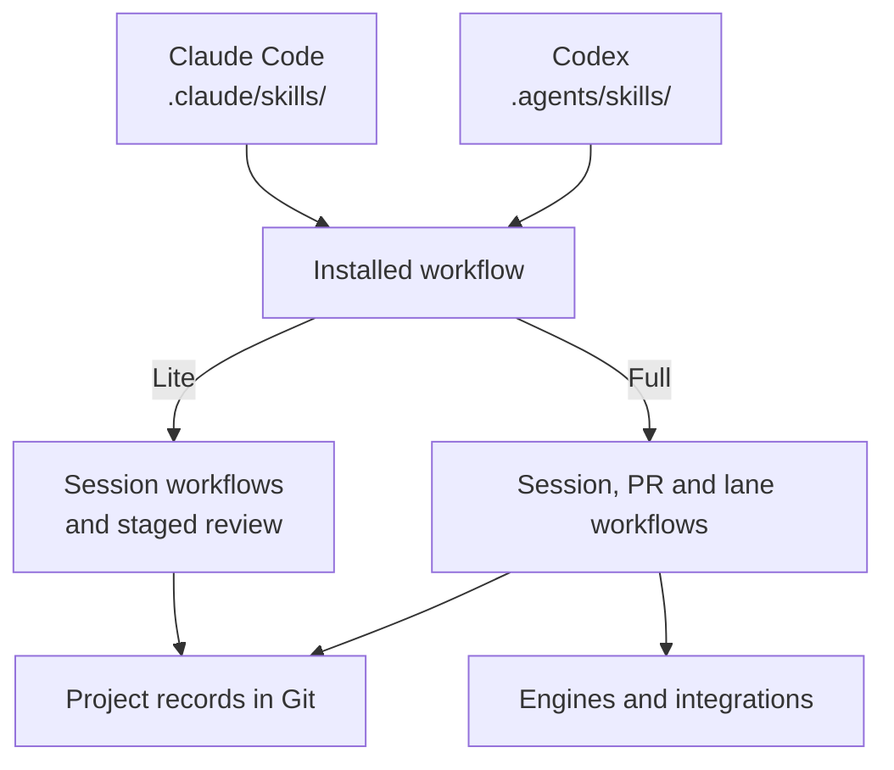
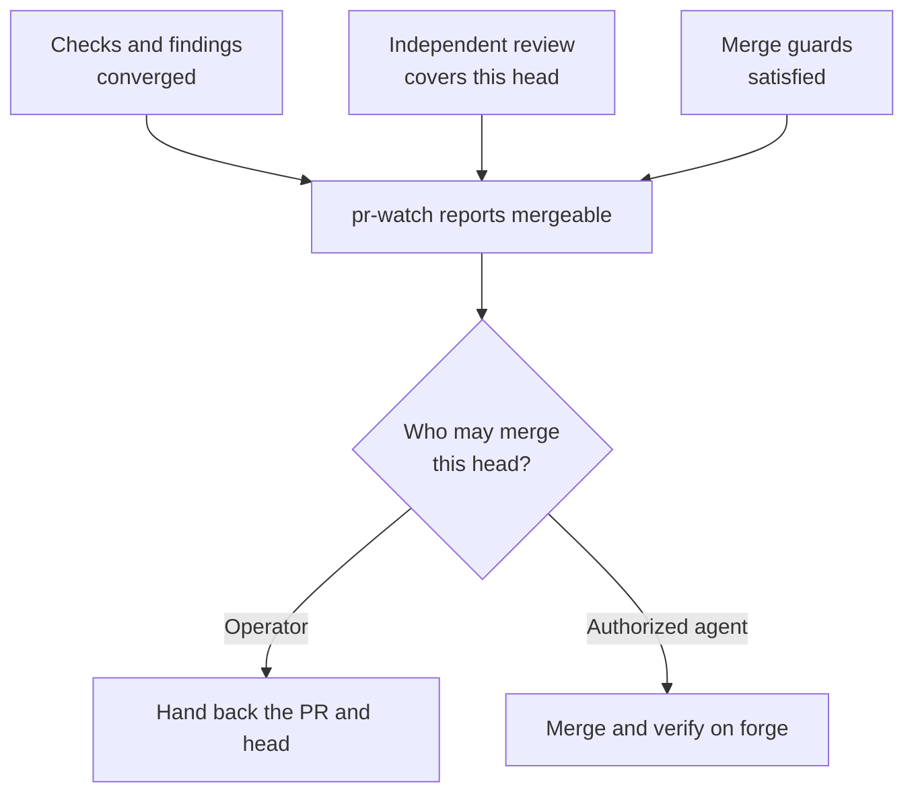
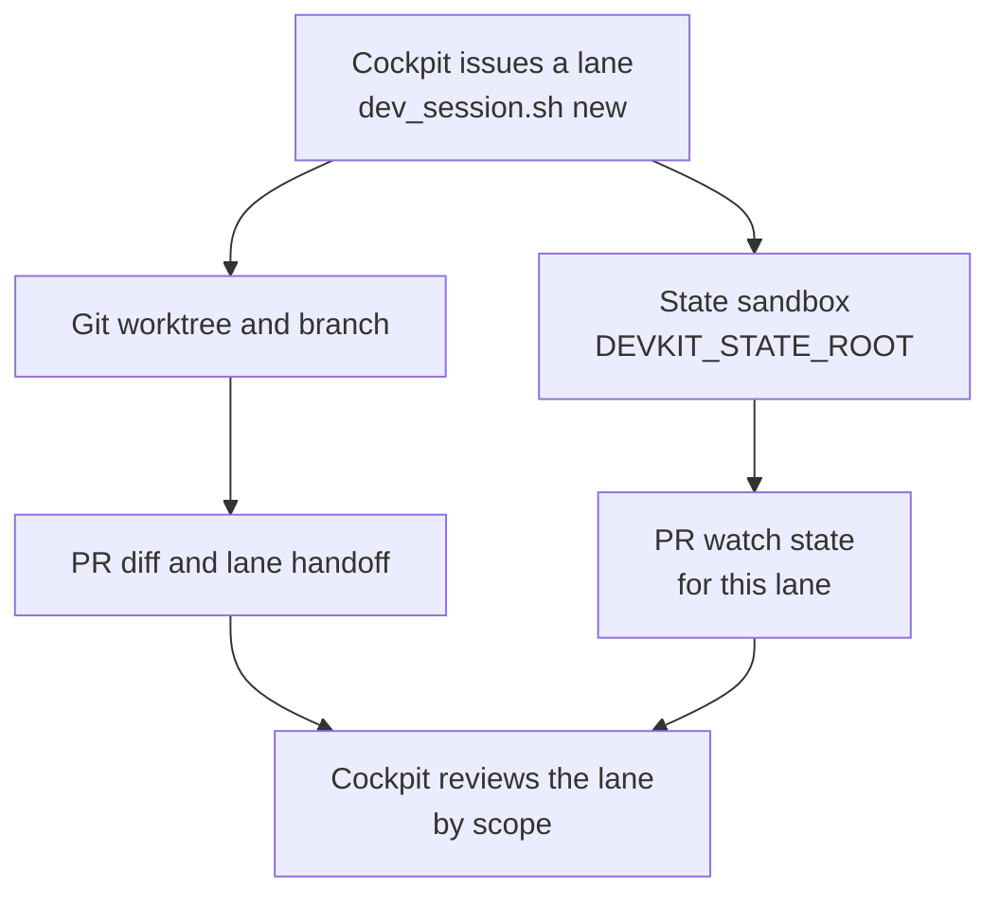
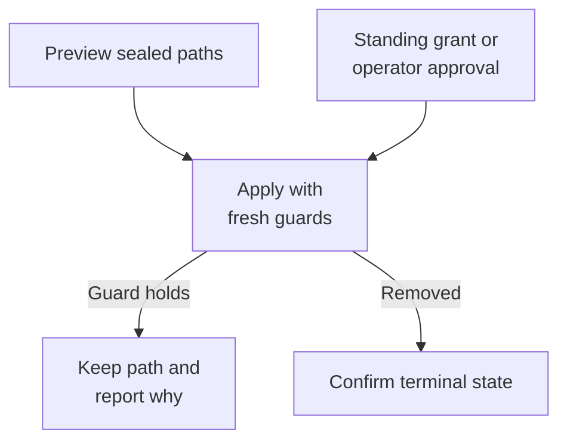
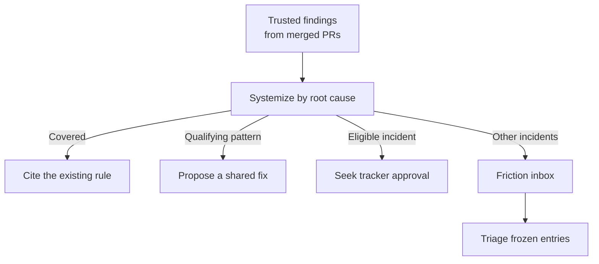

# Architecture

Claude Code and Codex enter the kit through their own skill bindings. The installed
profile determines which workflow they read, where the work is reviewed and what
record survives the session. For the commands to run, use the [developer guide](developer-guide.md).

## Component map

| What the session needs | Lite | Full |
| --- | --- | --- |
| Where to find project policy | The Lite workflows read `config/dev-model.yaml` directly. The repository can add source commands in its `AGENTS.md`. | The workflow reads configured paths, review policy and integration settings. Engines that use `kitconfig` also read its allowed local overrides. |
| How to pick up work | Read the living plan, friction inbox and Git state. When `backlog.path` is configured, the briefing reads the repository's story backlog and wrap-up updates its statuses. | Read the project records together with forge, CI and tracker evidence. Unavailable sources appear as gaps in the briefing. |
| Where review happens | Review the staged change before the wrap-up commit. A configured risk tier adds a fresh-context review and operator go-ahead when the staged change touches a declared path or the config itself. | Watch checks and independent review at the PR head. An authorized actor makes the merge decision after the gates settle. |
| Where work lands | Commit locally. With `vcs.protected_branch` set, push a session branch and open or update a PR for the operator to merge. | Open completed work ready for review. Parallel lanes hand their PRs back to the coordinating session, called the cockpit. |

The Lite contracts are [session start](agentic-dev-kit/lite/lite-session-start.md),
[review](agentic-dev-kit/lite/lite-review.md) and [wrap-up](agentic-dev-kit/lite/lite-wrap-up.md).
The drawings below follow **Full**. Its runtime adapters enter the
[shared workflow definitions](agentic-dev-kit/workflows/). Repository-wide
instructions live in `AGENTS.md`, which `CLAUDE.md` imports. When a workflow decision
changes, edit the shared definition so both clients receive it. See the
[runtime parity contract](agentic-dev-kit/runtime-parity.md).

### Source map

| When tracing… | Start here |
| --- | --- |
| Installation or upgrade | [`init.sh`](../init.sh) migrates supported Full config and renders unclaimed templates. [`kit_doctor.py`](../scripts/kit_doctor.py) inspects installed files against the manifest. Lite installation and upgrade run the inspector from the kit clone. See [ownership](ownership.md). |
| A project setting | [`kitconfig.py`](../scripts/lib/kitconfig.py) defines Full's config syntax and which keys may live in the gitignored `config/dev-model.local.yaml` overlay. `paths.engines` names the installed engine directory. |
| A PR finding or missing review | [`pr_watch.py`](../scripts/pr_watch.py) reads checks and findings and records review evidence. [`panel_prompt.py`](../scripts/panel_prompt.py) prepares the fresh-context review prompts. |
| A lane or its state | [`dev_session.sh`](../scripts/dev_session.sh) issues worktrees and reports their status. [`launch_lane.py`](../scripts/launch_lane.py) runs headless lanes and records their outcomes. [`state_paths`](../scripts/lib/state_paths/) resolves workflow artifacts. |
| A worktree or review round awaiting retirement | [`session_cleanup.py`](../scripts/session_cleanup.py) tracks session-owned paths and retained evidence. [`sweep_scratch.py`](../scripts/sweep_scratch.py) checks scratch dependencies. |
| A proposed reviewer change | [`review_eval.py`](../scripts/review_eval.py) compares reviewer output against historical cases. Its results measure the change to the reviewer. See the [evaluation guide](agentic-dev-kit/review-eval/reviewer-eval.md). |

## Session and pull-request lifecycle

```mermaid
sequenceDiagram
    accTitle: Who acts during a Full session
    accDescr: The operator chooses work after the briefing. The agent verifies the change, opens the pull request and follows checks and review. When the operator owns the merge, the agent hands back the reviewed head.
    participant O as Operator
    participant A as Agent
    participant F as Forge and CI
    A-->>O: Briefing from project records and live sources
    O->>A: Choose the work
    A->>A: Edit, check for a handoff, verify
    A->>F: Open ready PR and assert ready
    loop While checks or findings need action
        F-->>A: Checks and review findings
        opt A finding or failure needs a response
            A->>F: Push a repair or answer a finding
        end
    end
    opt Operator owns the merge
        A-->>O: Hand back the reviewed head and gate result
    end
```

`session-start` can record a check-settling baseline while reading PR state. Before
review, `wrap-up` asks what the next session will need that the PR, commits and tracker
leave unsaid. Put that information on the workstream's handoff entry and commit it on
the same PR. A lane puts its handoff in its PR description for the cockpit to reconcile.
Route friction when it occurs. At session end, run the full wrap-up on the operator's
request. See the [handoff and authority contract](agentic-dev-kit/workflows/wrap-up.md).

## Review evidence and merge authority

Read `converged` to see whether the watch loop has outstanding work in its observed
scope. At convergence, `review_owed` names the configured bots that still need a
request. An empty list calls for no request. A `null` calls for another poll and, if
the same head remains unreadable, fallback review. The REST backend reports read gaps
in `truncated_reads` and `unavailable_reads` and can only poll. See the
[PR-watch workflow](agentic-dev-kit/workflows/pr-watch.md) and [report fields](agentic-dev-kit/workflows/pr-watch/report-fields.md).

The default independent review runs a fresh-context lens on a standard change and
the panel on a safety-critical change. A configured bot can supply qualifying
current-head coverage. A fallback pass records a receipt against the reviewed SHA and
posts typed dispositions on the PR. The receipt's source and lens names are
self-reported. When configured, a verifier checks findings before disposition.
Later rounds may reuse a reviewed parent through the delta-review route. See the
[fallback review contract](agentic-dev-kit/fallback-review-panel.md).

Read `merge_blockers` for reasons a converged PR must wait, such as a check rollup
that is still settling. `done` is the legacy alias of `mergeable`. A non-lane PR
without a project merge policy goes to the operator for a decision on the exact head.

## Isolation and state

A worktree gives a lane its own checkout. Lanes that edit the same source file can
still conflict at merge, so the cockpit plans disjoint file footprints. The board's
`OVERLAP` column identifies observed collisions. `RUN` reads headless launcher
state from the lane session directory, where the launcher writes its receipt.
A successful runtime exit needs a `LANE-TERMINAL` line to declare `pr-ready`,
`no-pr` or `blocked`. A resumable Claude session can be resumed up to
`parallel.max_resumes` when the line is missing. A lane that exhausts that route,
or a Codex lane missing the line, is recorded as `stalled`. See the [headless
launcher contract](agentic-dev-kit/workflows/parallel-headless.md).

Run scope-aware `dev_session.sh pr-watch <scope>` in the cockpit to use the lane's
review state. The project and current request govern who lands a reviewed lane PR.
For this kit repository, check the operator's lane-merge decision in the
[living handoff](kit-handoff.md) before selecting a merge class. The portable
[parallel workflow](agentic-dev-kit/workflows/parallel.md) defines the wrapper's
eligibility checks.

The state resolver follows the owning workflow's read rules. A cache lookup can
choose a newer sandbox or production value. Triage approval state uses the session's
write path even for reads, so a decision in another session cannot authorize a write.

## Evidence retention and cleanup

With `scratch.session_registry` configured, inventories live under
`<git-common-dir>/devkit/<scratch.session_registry>/`. Linked worktrees share this
local record, and it survives removing a task checkout. Record completed results in
Git or on the PR. A seal can retain an exception that names unfinished work, its next
action and a deletion condition. Once that condition holds, `retire-evidence` previews
and applies the approved retirement and leaves a tombstone.

Retire a finished review round before allocating its successor unless it is
explicitly kept. A preview token binds the paths and seal. A standing `AGENTS.md`
grant or the operator supplies deletion authority. Fresh process and dependency
checks can still keep a path. A native Codex archive needs terminal confirmation and
another apply. For an unavailable inventory after a device renumbering, follow the
reconciliation procedure. Age-based sweeps have their own approval. See the
[cleanup contract](agentic-dev-kit/session-cleanup.md).

## Friction flywheel

**Triage** starts from the inbox. An operator decides which frozen entries to file,
archive or park. A tracker write needs approval of its exact payload and read-back
before the workflow accounts for it. See the [triage workflow](agentic-dev-kit/workflows/triage-friction-log.md).

**Systemize** starts from merged reviews. It trusts the configured operator and
reviewer identities and stops if neither supplies a trusted source. It checks for an
adequate existing rule first. A qualifying recurring cause earns a proposed structural
change, a check demonstrated on a past PR, or a prose rule for a judgment that a check
cannot make. A below-threshold finding from a single PR can reach tracker approval at
the configured severity. Other below-threshold incidents go to the inbox. See the
[systemize routing table](agentic-dev-kit/workflows/post-merge-systemize.md#authoritative-routing-declaration).

## Where to change behavior

| Change | Owning surface |
| --- | --- |
| Full project path, reviewer or integration | `config/dev-model.yaml`. When the kit introduces a key, migrate it through `init.sh`. |
| Workflow decisions, failure handling or approval | The shared definition for the installed profile. Extend a Lite adopter's sources in `AGENTS.md`. |
| Runtime invocation | The Claude or Codex skill binding and the [parity contract](agentic-dev-kit/runtime-parity.md). |
| Deterministic command or state behavior | The engine under `paths.engines` and its behavioral verification. |
| Full adopter's starting records | The corresponding template in `docs/templates/`. An adopter's populated plan and friction log belong to the project. |

This repository verifies changes with `make test`. Changes to a gate, launch authority
or merge authority in the engines named by [AGENTS.md](../AGENTS.md) also follow the
[safety-critical review contract](agentic-dev-kit/safety-critical-changes.md).
