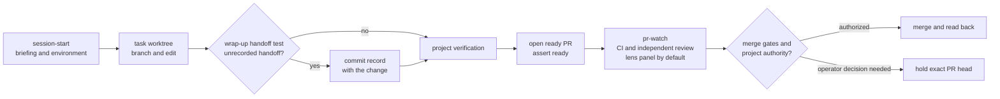

# Developer guide

Use this page when you want to do work with the kit. It gives the short route from a
task to the right command or agent workflow. For the component design and safety
boundaries, see [Architecture](architecture.md). The shared definitions under
[`agentic-dev-kit/workflows/`](agentic-dev-kit/workflows/) are the authority when a
guide and a workflow disagree.

Workflow names below are runtime neutral. In an agent session, invoke a workflow as
`/name` in Claude Code or `$name` in Codex. A workflow invocation is **not** a shell
command. Shell examples assume the kit's default `paths.engines: scripts`; use your
configured `paths.engines` directory in an adopted repository.

## Choose your starting path

| Your situation | Do this | Continue with |
| --- | --- | --- |
| Fresh repository made from the template | Run `./init.sh`, then inspect `config/dev-model.yaml`. | [Getting started](getting-started.md) |
| Existing repository with its own agent rules, config, or CI | Invoke `adopt` and review its selective install plan before it writes. | [Adopt workflow](agentic-dev-kit/workflows/adopt.md) |
| Repository that already has the kit | Invoke `upgrade` in its assigned task worktree to inspect drift, migrate config, and refresh kit-owned files. | [Upgrade workflow](agentic-dev-kit/workflows/upgrade.md) |
| A normal development session | Invoke `session-start`, use a task worktree, invoke `wrap-up` before review, then watch the PR. | [Session loop](#run-a-development-session) |

Do not use `cp -r` on a mature repository: it can overwrite the files whose
ownership `adopt` must inspect. Re-running `init.sh` migrates config and renders
unclaimed templates; it does not replace the drift inspection and file refresh in
`upgrade`.

For a refusal or unexpected report, use the [troubleshooting table](troubleshooting.md).
For upgrades and file edits, consult the [ownership reference](ownership.md).
For changes to these guides, run the [documentation checks](documentation-checks.md).

## Run a development session

1. Invoke `session-start`. It reads the configured handoff and friction log, the
   repository state, and available forge, CI, and tracker sources. An unavailable
   source is reported as a gap. The workflow recommends work but makes no changes.
2. Reuse the worktree assigned to this task, or create a dedicated linked worktree
   and task branch before editing. Keep unrelated work in its original checkout.
   In **this kit repository**, cockpit branches use `chore/<slug>` or `feat/<slug>`;
   `dev/` is reserved for isolated lanes. From the primary repository, this example
   creates a fresh task checkout from the fetched base:

   ```sh
   REPO="$(git rev-parse --show-toplevel)" || exit 1
   TASK_WORKTREE="$(dirname "$REPO")/devkit-update-guide"
   git -C "$REPO" fetch origin main || exit 1
   git -C "$REPO" worktree add --no-track -b chore/update-guide \
     "$TASK_WORKTREE" origin/main || exit 1
   cd "$TASK_WORKTREE" || exit 1
   ```

   Choose an unused branch and destination; a collision stops the example. Run
   edits, verification and commits in that task checkout. An adopter uses its own
   remote, protected branch and task-branch convention.
3. Make the change and run the repository's verification command. For this kit,
   run `make test` with a long enough tool timeout to receive the pytest summary.
   Its `check-syntax` target has the limitation recorded in [AGENTS.md](../AGENTS.md);
   inspect changed shell scripts separately until that gap is repaired.
4. Run `wrap-up`'s handoff test before requesting each PR's opening review,
   preferably before opening the PR. It asks whether the work left anything the PR, its
   commits and the tracker do not already record — a decision, an abandoned approach, a next step
   with no ticket. If so, it commits that to the workstream's entry in the
   configured handoff on the same PR, so one review covers both; if not, it commits
   nothing, which is the usual result. Route friction when you find it. Tracker
   writes need a decision on their exact payload. Run the full `wrap-up` to close a
   session that leaves half-finished state or decisions only in the conversation. Verify any final edits, then open completed work ready for review.
5. Invoke `pr-watch` for the exact PR, and continue through CI and review findings.
   Ready status starts review; it does not grant merge authority. Follow the
   project's merge policy for the final act.



For the full first-session walkthrough, use [Getting started](getting-started.md).
For the review loop and its stop conditions, use the [PR watch workflow](agentic-dev-kit/workflows/pr-watch.md).

## Read review status without confusing it with merge authority

| Report field | What to do with it |
| --- | --- |
| `converged` | The watch loop has no remaining checks or new findings to handle in its observed scope. Still inspect read gaps and the review request. |
| `review_evidence` | Inspect whether independent review covers the current head through bot coverage or a recorded receipt. A push requires evidence for the new head. |
| `merge_blockers` | Resolve the named blocker, or continue polling when the check rollup is settling. A receipt cannot override a current-head changes-requested review. |
| `mergeable` | The engine's merge gate is satisfied; the project's merge policy must also authorize the actor. |
| `done` | Legacy alias for `mergeable`; do not use it to mean the watch loop ended. |

Independent review is the kit's isolated lens panel by default, run at the converged
head under the [fallback review contract](agentic-dev-kit/fallback-review-panel.md).
A third-party review bot is opt-in through `review.bots`; when a configured bot is
down, the same pass runs, since an outage is not a waiver. The computed review class determines the required lenses,
and `panel_prompt.py` assembles each lens's prompt from the contract. The optional
verifier, whose compute is `review.fallback_panel.verifier_compute`, checks each
finding before disposition; it does not grant merge authority. Record dispositions with the
review receipt so the findings survive outside local watch state. Follow the
[watch loop](agentic-dev-kit/workflows/pr-watch.md) for review requests, round
budgets and contained LOW repairs.

When changing reviewer prompts or compute, use the kit's
[reviewer evaluation guide](agentic-dev-kit/review-eval/reviewer-eval.md).
`review_eval.py` compares reports against known-bug and clean cases, with an optional
verifier comparison. Citation matches and candidate false alarms need human
interpretation; an evaluation score is not a review of the PR being merged. The
case set depends on this kit's history and is a maintainer tool, not an adopter
installation requirement.

When writing or editing an instruction an agent reads (a workflow, a skill, a rule
or `AGENTS.md`), follow [writing for agents](agentic-dev-kit/writing-for-agents.md).
`AGENTS.md` has a line budget in `doc_budgets`; when the budget check warns, fold or
move text instead of adding more. Before changing `dev_session.sh`, the lane launcher
or the lane identity chain, read the
[parallel verification matrix](agentic-dev-kit/parallel-verification.md).

When changing a skill adapter's `description`, run
`uv run scripts/skill_routing_eval.py`; `make test` runs it too. It scores the
prompts in [`skill-routing/cases.json`](agentic-dev-kit/skill-routing/cases.json)
against every model-invoked skill's description, for each runtime, and fails when a
prompt does not reach its skill, a negative prompt does, or two descriptions overlap.
It is lexical, so a failure usually means the description lacks the words a request
uses. Whether a live client then invokes the skill is a separate, on-demand question
(#1221). Add a case when a real request missed its skill.

## Work in an isolated lane

Use a lane when its source-file footprint is disjoint from other active work. The
cockpit owns the shared handoff, friction log, review coordination, and merge
decision. A lane has a worktree, branch, and separate state sandbox.

From the repository root, substitute your own lowercase scope for `docs-index`:

```sh
scripts/dev_session.sh new docs-index --merge-class operator
scripts/dev_session.sh list
```

`new` prepares the lane. If a launcher is configured, it prints a command to run
in another terminal. If no launcher is configured, it prints a `source .../activate`
command; activate the lane and then start your agent. The command does not move the
current terminal into the worktree. For unattended lanes, use the shared
[parallel workflow](agentic-dev-kit/workflows/parallel.md) and its
[headless companion](agentic-dev-kit/workflows/parallel-headless.md); its launch
descriptor and wrapper carry the required environment and receipt.

`--merge-class operator` keeps the final merge with the operator. A `self` class
still needs project and current-request authority and must merge through the
cockpit's `dev_session.sh merge` wrapper. See the [task recipes](parallel-howto.md)
for watching, reconciling, and removing lanes.

The neutral `cheap`, `default`, and `expensive` tiers help choose compute. For an
interactive lane a suggested tier is not proof that a runtime applied a model or
effort setting; the operator applies it. A headless lane launched with
`launch_lane.py --tier <tier>` gets `models.runtime_mappings.<runtime>.<tier>` on its
argv, and its receipt records the compute and, for Claude, the token and cost usage.
Follow the [parallel workflow's tier route](agentic-dev-kit/workflows/parallel.md#per-lane-effort-tier-risk--reasoning-effort--model).

A lane finishes by naming its terminal state on its last line:
`LANE-TERMINAL: pr-ready #<n>`, `no-pr <reason>` or `blocked <reason>`. A headless
Claude lane whose runtime exits successfully without it is resumed up to
`parallel.max_resumes` times when its session can be resumed. A lane that still names
no terminal state, including a Codex lane without one, is recorded `stalled` and shows
so in the board's `RUN` column; a failed, denied or interrupted round is recorded as
such instead. `launch_lane.py --ticket <n>` hands the lane its GitHub
issue so the lane does not have to fetch it. `dev_session.sh <subcommand> --help`
prints a subcommand's usage without creating anything.

## Route friction and recurring findings

Route a finding when it is found. Record an incomplete or accumulating finding in
the configured friction log. An issue-shaped finding goes through tracker search and an exact-payload
decision first. Invoke `triage-friction-log` to freeze and review inbox entries;
its approval step decides which entries to file, archive, or park. A budget warning
alone does not authorize a tracker write or archive sweep.

`post-merge-systemize` reads merged PR review findings for recurring root causes.
It proposes a shared-rule change only when the configured pattern threshold is met,
and chooses the change in order: a structural change, then a check shown failing on
a pull request in the cluster, then a prose rule for a judgement call. The proposal
names its level and why each higher one does not work, and reports its net line
change. In this repository [`kit-enforcement.md`](kit-enforcement.md) is the
enforcement table it reads and updates.
The [triage](agentic-dev-kit/workflows/triage-friction-log.md) and
[systemize](agentic-dev-kit/workflows/post-merge-systemize.md) definitions specify
their preflight, state, approval, and recovery rules.

## Diagnose an installation

Run these from the repository whose installation you are inspecting, with
`scripts` replaced by `paths.engines` when needed:

```sh
uv run scripts/kit_doctor.py
uv run scripts/check_doc_budget.py
```

`kit_doctor` reports kit-owned file drift and installation properties. It also
reports explicit Codex lens and verifier model pins against the invoking client's
local model cache. That observation is advisory: an absent cache is skipped, an
unreadable cache is unavailable, and a comparable newer name is not proof of live
account access. It neither changes configuration nor changes the doctor's exit
status. Confirm client access before deliberately updating the reviewer compute in
`config/dev-model.yaml`.

For an upgrade, follow the [shared upgrade workflow](agentic-dev-kit/workflows/upgrade.md)
from the assigned worktree. Inspect the installation before replacing the installer;
compare runtime adapters with their recorded baseline when available, preserving
unclassified authored content. Missing baseline history needs inspection, not a
blanket overwrite. Preview Claude lens definitions using the adopter's merged
configuration, inspect the diff, and record the installed baseline after the
selected refreshes. A linked-worktree install reports shared hooks instead of
silently installing them; follow the workflow's explicit shared-hook installation
step.

For ordinary drift diagnosis, a `differs` result requires inspection: a hash mismatch cannot tell an older file from a local
edit. The document-budget command warns by default; its warning is a route to the
configured workflow, not permission to rewrite the narrative documents.

If a workflow stops, keep its exact branch, state, report, and PR identity. Resume
through that workflow's documented entry point after resolving the named cause.
Do not treat an unavailable forge or tracker as an empty result.

## Retain evidence and finish session cleanup

A session deletes what it created once nothing needs it: a review round once its
findings are recorded, a lens worktree once its report is retained, a throwaway clone
once its result is read, a merged lane through `dev_session.sh rm`. Ownership is the
exact path the session recorded when it made it, never a name or an age. Without a
standing grant, present those paths for the operator's approval. To grant it once,
copy the *Session cleanup* section of [`AGENTS-sections.md`](AGENTS-sections.md) into
your `AGENTS.md`; the grant covers only the session's own recorded paths, keeps every
engine preview and guard, and never covers an age sweep. The full `wrap-up` that closes a session finishes this
cleanup and reports what it removed and what it kept, with reasons.

When `scratch.session_registry` is configured, use the
[completed-session cleanup lifecycle](agentic-dev-kit/session-cleanup.md).
Start an inventory before allocating review rounds; track actual writers and
register disposable worktrees at their final commit. Keep package caches and
basetemps in scratch, separate from evidence you need to retain.

After writers and descendants end, enumerate the required reports, dispositions,
verification, compute receipts and supporting assets in an evidence manifest.
Seal it to retain content-addressed copies in the repository's shared Git metadata.
That local retention survives removal of a task checkout; it is not included in a
fresh clone or protected from deletion of the repository itself.

From the primary checkout, these commands discover inventories and report disk
and scratch state without deleting anything:

```sh
uv run scripts/session_cleanup.py list
uv run scripts/sweep_scratch.py --disk --json
```

Between review rounds, retire the finished round with `seal`, `preview` and
`apply --round <receipt-id>`; `allocate` refuses a new round while an earlier one is
unretired, unless you keep it on purpose with `--keep-previous "<reason>"`. A round
whose retirement was interrupted (`removing`) refuses the next allocation whatever
the reason; resume it with the same `apply --round` first.

Preview the selected inventory before requesting authorization for its exact paths.
The preview token binds the scope; it is not operator consent. The lifecycle guide
covers approved apply, kept paths and interrupted cleanup. App-managed Codex
worktrees use native archive after the guards allow it, followed by another apply
to confirm completion. A queued archive or a keep reason remains unfinished work.
If inventories turn `unavailable` after a macOS reboot with a refusal naming
`device (stored …, current …)` and every recorded round and worktree is gone (and no
worktree is still registered with Git), run `reconcile <session>` on each to preview the
rebinding and apply it with `--approve <token>` under authorization; it deletes
nothing. Reaching session-start or wrap-up does not itself authorize deletion; the
authority is the standing grant or the operator's approval.
