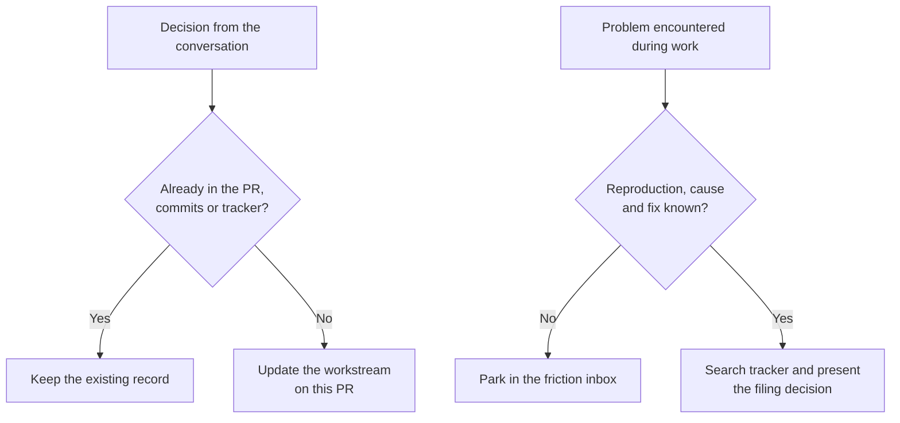

# Getting started

Suppose your project exports reports as CSV. A report with no rows downloads as
an empty file. You want it to include the column headers so a spreadsheet can open
it like any other report. This walkthrough follows that change from the first
briefing to a reviewed pull request. It assumes the full profile. If you use lite,
follow the shorter session below.

## Choose the installation route

| Your starting point | What to do |
| --- | --- |
| New project using the full kit | Choose **Use this template** on GitHub and clone the **new repository**. Set the paths and run the installer as described below. |
| Existing project adopting the kit | Start an agent in the target repository and give it the [adoption workflow](agentic-dev-kit/workflows/adopt.md). It inspects your existing files, asks which profile you want, and proposes what to reuse or install. Review that plan before it changes the project. |
| Project already using the kit | Follow the [upgrade workflow](agentic-dev-kit/workflows/upgrade.md). It identifies the installed profile and inspects the files before refreshing them. For a lite install, use its [lite upgrade instructions](agentic-dev-kit/workflows/upgrade.md#lite-profile). |

**Choose full** when the kit should watch CI and PR review, work with a tracker,
or coordinate isolated agent lanes. **Choose lite** when you want a living plan,
a friction inbox and a review before committing. Lite can open pull requests on
projects with a configured protected branch. Its workflows run in your agent
without installing engines or Git hooks in the project. [Profile selection](agentic-dev-kit/workflows/adopt.md#choose-the-profile)

### Prepare a full installation

The installer runs in POSIX `sh` with Git and standard macOS or Linux shell tools.
Install `uv` for the Python engines. The review tools use `git --no-lazy-fetch`,
which requires Git 2.44 or later. For this walkthrough, authenticate the GitHub CLI
in the environment that will watch the PR. [Developer guide](developer-guide.md)

```sh
git --version
uv --version
gh auth status
```

In a repository created from the template, open `config/dev-model.yaml` **before
running `./init.sh`**. Its tracked `paths` block points to this kit’s maintenance
records. Edit the following entries in the existing block to use the shipped
skeletons, or substitute your project’s own record paths. Preserve the other keys.

```yaml
  handoff: docs/handoff.md
  handoff_history: docs/handoff-history.md
  friction_log: docs/friction-log.md
  friction_log_archive: docs/friction-log-archive.md
```

Update the matching `path` and `archive` entries under `doc_budgets` to name the
same files. In `tracker`, set `backend`, `project_name` and `url` for this
project. For a project without a tracker, set `backend: none`, `project_name: ""`
and `url: ""` **before running the installer**. Pressing Enter at a prompt accepts
the displayed value. An upstream tracker URL left there gets written into the
project’s friction inbox and root agent guide.

From the new repository root, run `./init.sh` and answer the prompts. It renders
the root agent guides and unclaimed narrative files at the selected paths. Open
the generated `AGENTS.md` and replace the verification-command placeholder with
your project’s command. Check `vcs.protected_branch` and inspect `git diff`
before committing. In an existing repository, follow the installer handoff in
the adoption workflow.

The template's `review.safety_critical_paths`
identifies the kit's own files. Include the project's gate, destructive and
recovery paths in that list, or omit the key to apply the stronger review to
every change. Set `review.bots` to `[]` if you want the kit's review panel to
handle independent review. [Safety doctrine](agentic-dev-kit/safety-critical-changes.md) · [Review panel](agentic-dev-kit/fallback-review-panel.md)

Read the installer's message about the pre-push hook. For example, `deferred`
means a linked checkout shares the hook directory. Follow the installation
instructions it prints. The rendered root guides and living records belong
to your project. [Ownership](ownership.md) · [Troubleshooting](troubleshooting.md)

### Values you don't want in git

If approvals use direct messages, keep the operator's notification identity in
`config/dev-model.local.yaml` and leave the tracked `notify.user_key` blank.
The full profile reads supported local values over the tracked configuration.
The reader defines which keys the local file may contain. [Config reader](../scripts/lib/kitconfig.py)

```yaml
notify:
  user_key: "U0XXXXXXXXX"
```

## Start a lite session

Invoke `session-start`. It reads the configured plan and inbox, the working tree,
recent commits and the story backlog when configured. Pick a task, make the
change, and verify it with the project's command. Invoke `wrap-up` to stage the
intended paths and run the lite `review` on the staged change. In Claude Code,
invoke skills as `/session-start` or `/wrap-up`. In Codex, use `$session-start`
or `$wrap-up`. [Lite briefing](agentic-dev-kit/lite/lite-session-start.md) · [Lite wrap-up](agentic-dev-kit/lite/lite-wrap-up.md)

Ordinary lite review uses the author's session to read the diff. If the change
triggers the configured risk tier, a reviewer in a fresh context also reads it
and the operator gives the go-ahead before commit. With `vcs.protected_branch`
configured, wrap-up commits on a session branch and opens a PR. Otherwise it
commits on the checked-out branch. [Lite review](agentic-dev-kit/lite/lite-review.md) · [Lite wrap-up](agentic-dev-kit/lite/lite-wrap-up.md)

## Brief the full session

Open your agent in the project. Invoke `$session-start` in Codex or `/session-start`
in Claude Code. Enter these invocations in the agent session. Run shell commands in the terminal.

For the CSV change, a **briefing excerpt** might read like this:

```text
Soon
  • Write column headers for an empty CSV report    [S · default · inline · local]   handoff / Reports

My pick: take the empty-report case. The CSV fixtures and the project test command are available here.
```

The tags identify size, model tier, execution mode and environment. The source
pointer lets you read why this is next. If a case needs a fixture the session
cannot access, the briefing keeps it visible and names what would unblock it.
If the tracker read fails, the briefing reports the gap. An unreadable handoff
or friction inbox stops the briefing until you restore it or correct its path.
[Session-start contract](agentic-dev-kit/workflows/session-start.md)

## Make the change

Reuse the assigned linked worktree and task branch, or create them before editing.
For the CSV example, use one worktree for the export writer and its tests.
Exercise both an empty report and a report with rows. The first should now contain
the header line. The second should keep its original columns, order and data.
Run the project's verification command in that same checkout. If you are changing
the kit itself, that command is `make test`. [Worktree setup](developer-guide.md#run-a-development-session)

## Decide what the next session needs

Before you request the opening review, run `wrap-up`'s handoff test. In this
example the diff and tests explain the header change. If the PR, commits and
tracker also hold the next step, leave the living plan alone. Suppose instead the
operator decides during the conversation to compare the export against a partner's
sample before changing the delimiter, and no issue records that. Update **Reports**
in the configured handoff on the same PR. A next step someone can act on would be
“Obtain the partner's sample from the operator and compare its delimiter with the
export fixture.” [Wrap-up contract](agentic-dev-kit/workflows/wrap-up.md)

Route friction when you encounter it. Suppose the fixture passes from the project
root but the test runner in your editor cannot find it. Record what reproduces
the failure and the next diagnostic in the friction inbox while the cause is still
unknown. If you already know the reproduction, mechanism and fix, search the
tracker for a duplicate and present the proposed ticket for approval. Park the
finding in the inbox when that filing route is unavailable. [Friction routing](developer-guide.md#route-friction-and-recurring-findings)



## Open the PR and follow review

Verify any handoff edit with the rest of the change. Open the completed PR ready
for review. In that task checkout, resolve the PR for the branch you just pushed
and run the ready assertion immediately. The template uses `scripts`. Substitute
your configured `paths.engines` in a vendored install. [PR-watch contract](agentic-dev-kit/workflows/pr-watch.md)

```sh
pr_number=$(gh pr view --json number --jq '.number') &&
  uv run scripts/pr_watch.py "$pr_number" --assert-ready
```

Invoke `$pr-watch <PR-number>` in Codex or `/pr-watch <PR-number>` in Claude
Code. The workflow monitors checks, reads findings, and asks for or performs the
configured independent review of the current head. For example, if review finds
the empty-report path skipped the writer's normal column ordering, repair it in
the task worktree, run verification, push and watch the new head. If the only
blocker is a check rollup that has not settled, poll again. When the report says
`mergeable`, use the project's merge policy to identify who may merge. Hand the
operator the PR and reviewed head when that decision belongs to them.
[Reading the watch report](agentic-dev-kit/workflows/pr-watch/report-fields.md)

## Finish the session

Request the full `wrap-up` if the session ends with an unfinished task, an
unrecorded decision or friction still to route. When there is nothing else to
record, a session whose PRs passed the handoff test does not need one. You should
clean up what the session created as you go either way. Preview the exact
paths the session recorded, apply under the project's cleanup grant or operator
approval, and report what the guards kept. [Cleanup lifecycle](agentic-dev-kit/session-cleanup.md)

The next briefing reads the workstream and the inbox. `triage-friction-log`
revisits parked inbox entries for filing, archiving or continued investigation.
`post-merge-systemize` reads a different source, the review findings on merged
PRs, and looks for recurring causes that warrant a shared change. [Triage](agentic-dev-kit/workflows/triage-friction-log.md) · [Post-merge systemize](agentic-dev-kit/workflows/post-merge-systemize.md)
