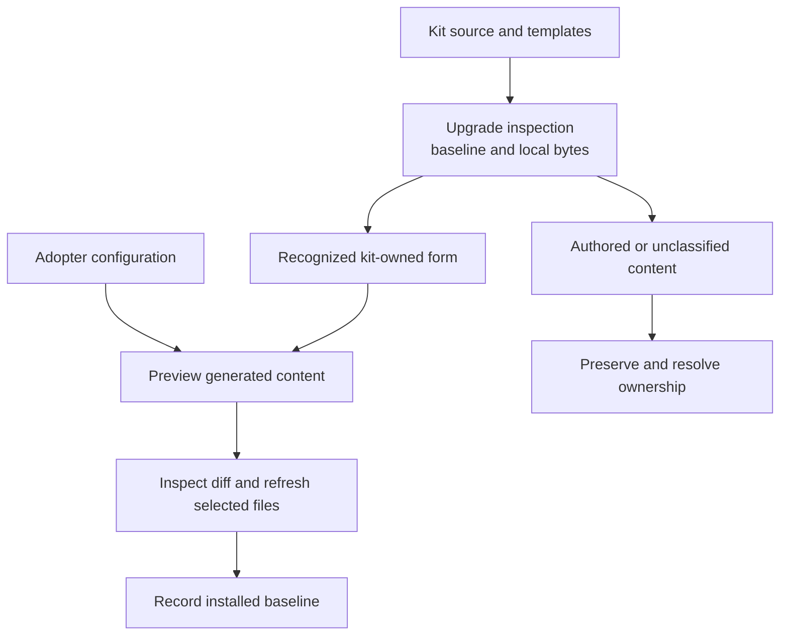

# Ownership and safe edits

Ownership answers who decides a file's content and how an upgrade treats it.
Location alone is not proof: an adapter beside a kit file can contain adopter-authored
policy. Start with the merged configuration, installed baseline and
[`kit_doctor.py`](../scripts/kit_doctor.py) report in the target repository.

| Surface | Source of authority | How to change or refresh it |
| --- | --- | --- |
| `config/dev-model.yaml` and allowed `config/dev-model.local.yaml` overlay | Adopter's project choices; shared reader defines supported syntax | Change project values in configuration. Upgrade migrates missing keys while preserving supported existing values. Keep secrets in the allowed local mechanism. |
| Engines under `paths.engines` and kit source templates | Kit source and the installed manifest | Use [upgrade](agentic-dev-kit/workflows/upgrade.md) to inspect drift, reconcile local engine edits and refresh selected files. Do not use a hash mismatch as permission to discard work. |
| Shared workflow definitions under `docs/agentic-dev-kit/workflows/` | Runtime-neutral behavioral contract | Change shared behavior here, then verify bindings still enter it. Runtime-specific copies of policy drift apart. |
| `.claude/skills/`, `.agents/skills/` and companion interface files | Known generated form or adopter-authored content, as classified against the baseline | Refresh recognized kit forms through upgrade. Preserve `adopter-owned` content and inspect unavailable baseline history. See [runtime parity](agentic-dev-kit/runtime-parity.md). |
| Claude lens definitions | Adopter's merged review configuration and kit rendering source | Preview the render and inspect its diff before replacement; do not copy the kit's model choices into another project. |
| Root `AGENTS.md`, `CLAUDE.md`, handoff and friction documents after adoption | Adopter's rendered and claimed content | Edit as project records. The installer seeds missing or explicitly unclaimed templates; upgrade's no-clobber route preserves existing files. In this kit, live records use `docs/kit-*.md`; `docs/handoff.md` is shipped starting content. |
| Shared hook shim in Git administration | Deliberate installation for all linked checkouts | Follow the explicit shared-hook step in upgrade. A task worktree does not own the shared hooks merely because it can see them. |
| Lane source checkout and branch | Assigned lane's declared source footprint | Edit only assigned files; cockpit owns shared narrative coordination. A worktree isolates source edits, not permissions to overlap another lane. |
| Lane workflow state | `DEVKIT_STATE_ROOT` and the configured state-path resolver | Use the engine's resolved paths, including its workflow-specific read/write rules. Do not copy approval evidence from another session or construct a production `state/` path by hand. |
| Review rounds and disposable scratch | Allocation receipt and session inventory | Record ownership and writers before review. Discard completed payloads by default; retain only an exception that names its unfinished task, next action and deletion condition, and retire it through `retire-evidence`. A temporary directory name is not deletion authority. |
| Sealed session evidence | `<git-common-dir>/devkit/<scratch.session_registry>/` and its `session.json` index | Holds only retention exceptions; retire them through `retire-evidence` under operator authorization, never by hand. This local evidence survives task-worktree removal, but does not travel in a fresh clone. Follow [cleanup](agentic-dev-kit/session-cleanup.md) for preview and apply. |
| This repository's documentation tooling and CI | Maintainer source under `tooling/docs/` and `.github/workflows/` | Run [documentation checks](documentation-checks.md) when editing reader guides. This tooling is repository-only; adopting the engines does not require Node or a browser. |

## From source to installed content

The [upgrade contract](agentic-dev-kit/workflows/upgrade.md) governs inspection,
selection and baseline recording. Recording a baseline is a write after the selected
installation; it is not a way to make an unexplained drift report disappear.
The manifest records ownership and provenance, not permission to overwrite or delete.
For runtime state and retention relationships, see
[Architecture](architecture.md#isolation-and-state).
