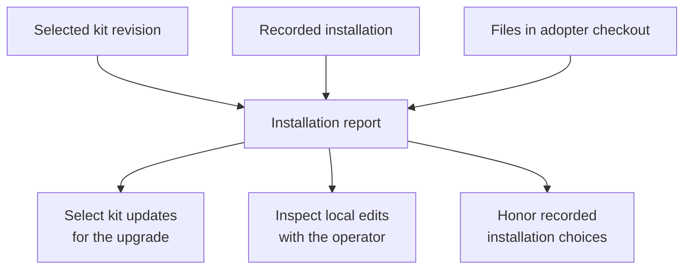

# Ownership and safe edits

A checkout can contain a kit engine, a skill written by the adopter, and a living
plan full of project decisions. Those files can all appear in the same upgrade diff.
Use the install profile, the recorded baseline and the file's role to decide which
copy to take. The [upgrade workflow](agentic-dev-kit/workflows/upgrade.md) defines the procedure.

## From source to installed content

Compare the upstream copy, the bytes recorded for the previous installation and the
bytes in the adopter checkout. For example, when the checkout still matches the
trusted baseline and upstream has changed, the report can identify a `stale` file.
When the checkout and upstream have both moved, inspect `stale-and-edited` before
taking a new copy. A plain `differs` leaves the cause open. Recording a new baseline
after the approved refresh gives the next upgrade its comparison point.

## Project records and policy

| File | Who changes it and why |
| --- | --- |
| Living plan, friction inbox and their project records | The adopter owns the content. Point the kit at the project's files. This source repository uses `docs/kit-handoff.md` for its own work and ships `docs/handoff.md` as starting content. |
| `config/dev-model.yaml` | The adopter sets paths and project policy using the schema for its profile. Full's `init.sh` migrates supported config and seeds unclaimed templates. Lite uses the small schema in [Lite adoption](agentic-dev-kit/workflows/adopt.md#lite-profile). |
| Full `config/dev-model.local.yaml` | The checkout owner can set keys accepted by the [config reader](../scripts/lib/kitconfig.py), including `systemize.operator_logins`. Keep the overlay gitignored. A fresh clone or plain linked worktree reads tracked values until it has its own overlay. |
| `AGENTS.md` and `CLAUDE.md` | The adopter maintains its root instructions. For Lite, keep the kit's session-discipline bullets and put project-specific source commands beneath the `session-start` or `wrap-up` headings. For Full, the installer seeds missing or explicitly unclaimed root guides. |

## Lite installation

Run the inspection from the **kit clone** against the **adopter's checkout**. During
adoption, `kit_doctor.py --verify-lite` verifies the selected install and its skill
bindings. During an upgrade, `kit_doctor.py --upgrade-lite` compares against the
adopter's **committed** `kit-manifest.json`. A missing committed baseline stops the
Lite upgrade. Recording a baseline from the new kit at that point would erase the
comparison with what the repository installed. See [Lite upgrade](agentic-dev-kit/workflows/upgrade.md#lite-profile).

| Surface | How an upgrade treats it |
| --- | --- |
| Workflows under `docs/agentic-dev-kit/lite/` | Kit-owned. If an edit belongs to the project, agree where to move it before taking the upstream copy. `--keep` applies only to a skill. |
| Runtime skills and existing Claude commands | The report distinguishes a kit skill, a skill the operator kept, and a skipped skill whose installation would shadow a retained command. Review any `decide` row with the operator. |
| Session-discipline section and backlog | Review proposed changes to the kit's `AGENTS.md` bullets separately from the repository's source commands. When `backlog.path` is configured, the repository owns the stories and Lite wrap-up maintains their statuses. |

## Full installation

| Surface | How an upgrade treats it |
| --- | --- |
| Engines under `paths.engines` and source templates | Inspect drift against the selected kit. Reconcile a local engine patch with the operator before refresh. Templates supply starting content for adopter-owned documents. |
| Shared workflows and runtime bindings | The definitions under `docs/agentic-dev-kit/workflows/` own the behavior. Inspect `.claude/skills/`, `.agents/skills/` and companion files against their generated forms and baseline history. Preserve adopter-authored content or unclassified bindings while ownership is settled. See [runtime parity](agentic-dev-kit/runtime-parity.md). |
| Claude lens definitions | Preview the render from the adopter's merged review configuration and inspect its diff before replacement. |
| Hook shims in Git administration | Linked checkouts can share their hooks. Follow the explicit shared-hook installation step in [Full upgrade](agentic-dev-kit/workflows/upgrade.md) so a task checkout cannot change the other checkouts' hooks unexpectedly. |

## Working files and retained evidence

| Location | Who owns the contents |
| --- | --- |
| Lane worktree and branch | The lane edits its assigned source files. The cockpit coordinates overlapping work and owns the shared handoff and friction log. |
| Lane state sandbox | The lane's workflow uses `DEVKIT_STATE_ROOT` and its prescribed read and write paths. Scope-aware PR watch in the cockpit uses that same state. See [isolation and state](architecture.md#isolation-and-state). |
| Registered review rounds and disposable scratch | The session that created a path records it and its writers. A round can retire once its findings or receipt are recorded and the guards allow removal. |
| Retained evidence in shared Git metadata | A seal may retain evidence for unfinished work, naming its next action and deletion condition. Linked worktrees share that local copy. Use `retire-evidence` to preview and apply authorized retirement. See the [cleanup contract](agentic-dev-kit/session-cleanup.md). |
| Documentation tooling and CI in this kit repository | Maintainers run the [documentation checks](documentation-checks.md) when editing the reader guides. The Node and browser dependencies belong to this check. |
