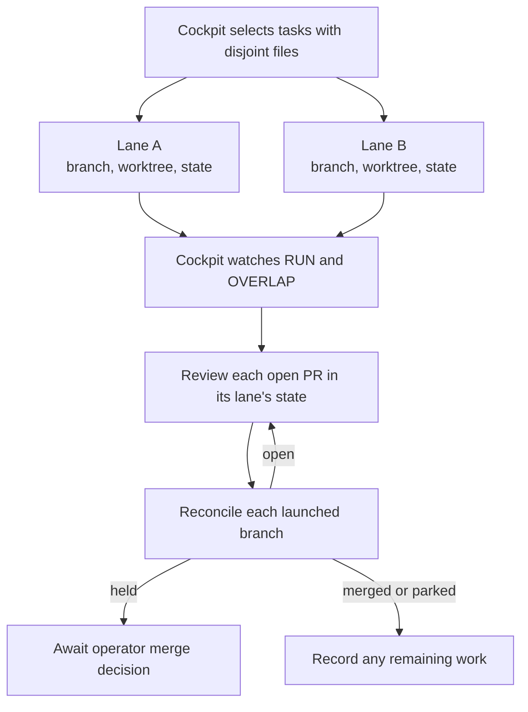

# Parallel dev sessions

Use parallel lanes in a full installation when independent tasks can change
different files. The **cockpit** is the session that plans the batch, watches its
pull requests and keeps the shared handoff. Each **lane** gets a source checkout
and a separate directory for workflow state. For an ordinary change by a single
session, a dedicated task worktree is sufficient. [Development session](developer-guide.md#run-a-development-session)

[`dev_session.sh`](../scripts/dev_session.sh) prepares lanes, displays their
state and removes finished worktrees. [`reconcile_sessions.sh`](../scripts/reconcile_sessions.sh)
looks up the result for each launched branch. The in-session front-end is the
shared [`parallel`](agentic-dev-kit/workflows/parallel.md) workflow. These links use
the template default `paths.engines: scripts`; a namespaced adopter substitutes its
configured directory, such as `scripts/devkit`.

## What a lane is

A lane has a source checkout and a state directory:

- **its own git worktree** on a **fresh branch** off `origin/<base>` — so two lanes
  never share a working tree or step on each other's checkout;
- **its own state sandbox** — `DEVKIT_STATE_ROOT` directs state writes into the
  lane's directory. Interactive activation exports it. A headless launch also
  writes a worktree marker for tool calls that start in a fresh shell. [State resolver](../scripts/lib/state_paths/)

The cockpit edits the files configured by `paths.handoff` and
`paths.friction_log` and coordinates review. Each lane puts its handoff in its
**pull request description** so the cockpit can collect it during reconciliation.
For work in the kit repository itself, consult the **Whole-kit plan** in the living
handoff before issuing a lane. Its D2 decision requires `--merge-class operator`
and leaves lane merges to the operator while the hold applies. [Kit handoff](kit-handoff.md#whole-kit-plan)

## When parallelism is safe — disjoint file footprints

This is the one rule that matters: **two lanes are safe together only when no source
file is edited by both.**

The state sandbox makes concurrent *scratch-state* writes safe. It does **nothing**
for two branches editing the same source file — that's a merge conflict plus a diluted
review at PR time, and no amount of sandboxing prevents it. So before launching a
batch, **map each candidate's file footprint** and only run truly disjoint work
concurrently. Footprint-mapping is a separate, deliberate step from isolation — the
sandbox prevents *state* collisions, not *source* merge conflicts.

Rule of thumb: parallelize independent features/areas; keep anything that touches a
shared module, schema, or config in the same lane and run it sequentially.

## The workflow



### 1 · Plan the batch — `parallel plan`

Don't spin up lanes ticket-by-ticket. Compose the batch deliberately:

1. **Orient** — `scripts/dev_session.sh list` + `git worktree list` show the file
   territory already claimed by in-flight lanes; exclude those footprints.
2. **Cluster by footprint** — group candidate tickets by the files each touches (read
   the ticket and grep the code; don't infer from the title). Pick **at most one per
   cluster**; the rest go sequential.
3. **Stale-premise pre-flight** — drop any candidate whose fix may already be shipped
   (a checklist item matching a recently merged PR, a "Done" state that was a bot
   auto-complete). Verify against live code before recommending it.
4. **Scope outward-safe** — a lane that would push to an external system or send a
   notification is scoped to its *in-repo half*; the outward step stays an operator
   action after merge.
5. **Choose a tier and merge class.** Select the compute to request (`cheap`,
   `default` or `expensive`) and who can land each PR. Use `operator` for
   interactive lanes. For unattended work, check both the project's policy and
   the operator's request before proposing a class.

The exact per-step commands, plus the effort-tier and merge-class tables, are in
[`workflows/parallel.md`](agentic-dev-kit/workflows/parallel.md#planning-a-batch--parallel-plan-focus)
— this doc keeps only the reasoning behind each step.

### 2 · Launch each lane — `dev_session.sh new`

Each `new` creates the worktree + branch + sandbox and persists the merge class.
For an interactive operator it prints launch or activation guidance. With
`--headless`, it writes a sticky on-disk marker and a canonical one-shot JSON
descriptor. Codex and Claude headless lanes use the kit-owned wrapper. Its child
independently observes Git, filesystem, state, and process identity before `exec`;
the receipt binds that observation to the launch request. Native agent dispatch
does not replace the descriptor environment and receipt chain. Omitting
`--merge-class` fails safe to
`operator`.
The exact command, every flag, and the headless JSON descriptor are in
[`workflows/parallel.md`](agentic-dev-kit/workflows/parallel.md#starting-a-new-session)
(interactive) and
[`workflows/parallel-headless.md`](agentic-dev-kit/workflows/parallel-headless.md)
(unattended); for task-oriented recipes, see [`parallel-howto.md`](parallel-howto.md).

### 3 · Each lane works to a green, ready-for-review PR

A lane that delivers a change hands the cockpit a ready PR. Completed work
opens ready by default, and the lane immediately runs `--assert-ready` before review
polling. Draft is reserved for material unfinished work that must already exist remotely
because required forge-hosted validation cannot run before the PR exists; that lane owns
the draft assertion, completion, ready transition, and ready assertion. Active CI
polling, narrative ownership, branch hygiene, and the no-merge boundary remain in the
same contract. The cockpit coordinates the remaining review and merge decision.

The headless contract also asks the lane to end its final text with one terminal line:
`LANE-TERMINAL: pr-ready #<n>`, `LANE-TERMINAL: no-pr <reason>` or
`LANE-TERMINAL: blocked <reason>`. The headless launcher counts a lane as `completed`
only with that line. A Claude lane whose runtime exits successfully without it is
resumed in the same session up to `parallel.max_resumes` times; a lane that still names
no terminal state is recorded `stalled` (exit 75), as is a Codex lane without one,
which cannot be resumed this way. The contract further requires every part of a shell
command to be allowed (one refused part ends the run, so one simple command per call
is the safe default), has the lane write commit
messages and PR text to files under `<state.dirname>/lane/` and pass them with
`git commit -F` and `gh pr create --body-file`, and undoes changes with
`git restore`. Fetch the
contract yourself with `dev_session.sh print-contract`, or read it in
[`workflows/parallel-headless.md`](agentic-dev-kit/workflows/parallel-headless.md#the-lane-contract-preamble-inject-this-verbatim)
— this guide summarizes the lifecycle without copying the verbatim contract.

### 4 · Watch the board — `list --watch`

```bash
scripts/dev_session.sh list --watch        # re-render every 30s
```

A leading `*` marks a row whose observed state changed since the last frame.
Read `RUN` for the headless wrapper's process or receipt status. `completed` can
mean the lane reported a ready PR, no PR or a blocker. Read `terminal.lane_state`
in its receipt to see which. `OVERLAP` names lanes changing the same file. A
`?` there means a footprint could not be read, so other rows also lack a complete
comparison. [Board columns and refresh options](agentic-dev-kit/workflows/parallel.md#live-board--parallel-list---watch-interval)

### 5 · Reconcile the batch before writing the handoff

Keep the actual branches and base you launched. A bare scope passed to
`scripts/reconcile_sessions.sh` expands to the configured `<prefix>/<scope>`.
For a custom prefix or branch, pass the full branch name if it contains a slash.
For a slash-free name, use an exact `--match` while its local or remote branch
exists, then check that the output includes it. If that ref has gone, inspect the
PR by its head branch before accounting for the lane. Reconcile each base
separately with `--base` when it differs from the configured protected branch.

| Row | What the cockpit does |
| --- | --- |
| `open` | Read the detail, follow the scoped review or finish the outstanding work, then reconcile again. |
| `held` | Tell the operator which PR is ready for their merge decision. The PR remains open. |
| `parked` | Inspect the reason and preserve any recoverable work. Name the parked item in its workstream when closing the batch. |
| `merged` | Read the PR's handoff and remove the lane once its state is no longer needed. |

On a repository or forge read error the reconciler can refuse the report entirely.
The [wind-down recipe](parallel-howto.md#use-case-5--wind-a-session-down)
shows the commands and exit codes.

## Model / effort tiering per lane

The risk read from planning suggests a neutral tier (Principle #7): a mechanical
sweep may use `cheap`, while a subtle decision may warrant `expensive`. Keep the
recommendation in the lane handoff. Interactive `new` prints launch guidance; the
operator applies a model or effort control if the runtime exposes one. For a
headless lane, pass the tier to the wrapper: `launch_lane.py --tier <tier>` reads
`models.runtime_mappings.<runtime>.<tier>` and puts that runtime's model and effort
controls on the lane's argv, and refuses before launch when the tier is not mapped.
Without `--tier` the wrapper inherits the client's compute. The receipt's
`request.compute` records the model and effort requested on the command line.
The client may fall back to its default if it does not recognize an effort value.
Claude reports usage for the initial launch and each resume separately. Codex's
final-text transport supplies no usage figures. Read the
[shared tier route](agentic-dev-kit/workflows/parallel.md#per-lane-effort-tier-risk--reasoning-effort--model)
before claiming that a lane ran at a particular model or effort.

## A worked example

Suppose a project has this ticket set. Planning clusters it by footprint:

| Ticket | Touches | Cluster |
|---|---|---|
| Add rate-limit to the auth endpoint | `auth/` | A |
| Rename the metrics module | `metrics/` (repo-wide import sweep) | B |
| Fix a typo in the CLI help | `cli/help.py` | C |
| Tighten the auth token TTL | `auth/` | A |

The auth tickets share `auth/` (cluster A), so run one now and defer the other.
Prepare the disjoint interactive lanes:

```bash
scripts/dev_session.sh new auth-ratelimit --merge-class operator --runtime codex
scripts/dev_session.sh new metrics-rename --merge-class operator --runtime codex
scripts/dev_session.sh new cli-help-typo --merge-class operator --runtime codex
```

These commands prepare isolation, runtime guidance, and merge class; they do not
start an agent or set a model tier. Use each printed launch or activation command
in another terminal, then apply the suggested tier through the runtime when that
control is available. As each lane finishes, it opens a ready PR and asserts
readiness. Follow each from the cockpit using its own scope. The operator
decides whether to merge each reviewed PR.
Reconcile the lanes from the cockpit, then run the joint wrap-up: the merged PRs
record what shipped, so the handoff (`paths.handoff`) only gains what remains held or
parked, in the entry of each workstream it belongs to.

## See also

- [`parallel-howto.md`](parallel-howto.md) — the task-oriented companion: step-by-step
  recipes per use case, and *what actually happens* when you run each `parallel` verb.
- [`PRINCIPLES.md`](../PRINCIPLES.md) #3 (cockpit + isolated lanes), #4 (merge classes),
  #7 (effort tiering).
- [`agentic-dev-kit/workflows/parallel.md`](agentic-dev-kit/workflows/parallel.md) — the shared workflow, and
  [`agentic-dev-kit/workflows/parallel-headless.md`](agentic-dev-kit/workflows/parallel-headless.md)
  for unattended-lane launch mechanics.
- [`docs/getting-started.md`](getting-started.md) — the single-session loop this sits on top of.
