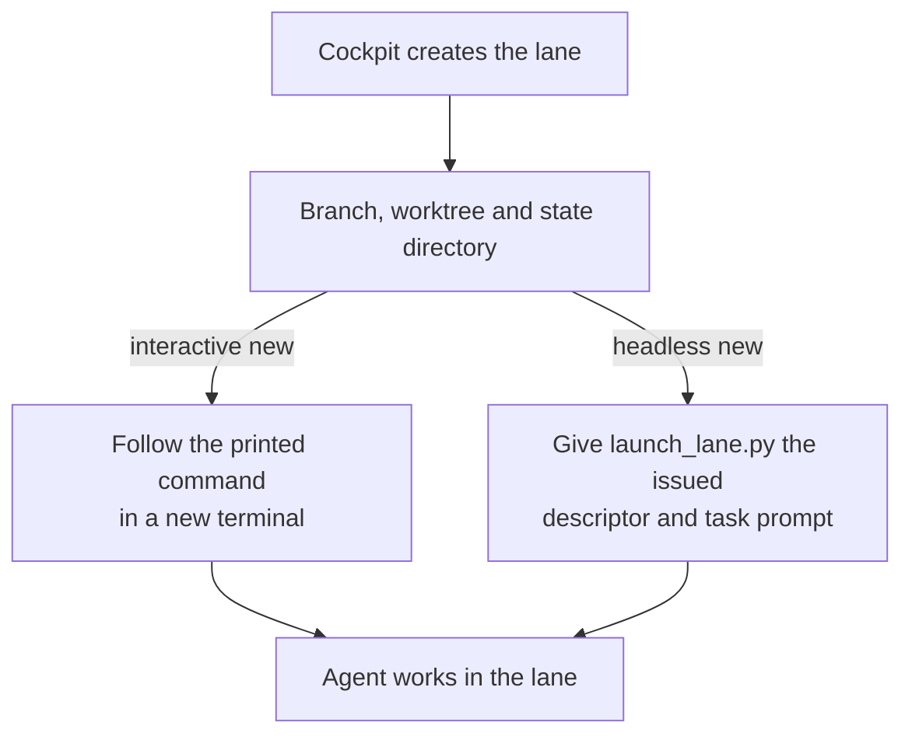

# Parallel sessions — a step-by-step how-to

Use these recipes to prepare a full-profile lane, start its agent, inspect its PR
and retire the worktree. The [parallel development guide](parallel-dev.md) explains
how to decide which tasks can run side by side.

Examples use the template default `paths.engines: scripts`. If you adopted the kit
under `scripts/devkit`, substitute that configured directory. Invoke the shared
workflow as `/parallel` in Claude Code or `$parallel` in Codex.

The examples use operator-class lanes. In the kit repository, consult the
**Whole-kit plan** before launching or merging a lane. The D2 hold assigns all
lane merges to the operator while it applies. [Kit handoff](kit-handoff.md#whole-kit-plan)

## The mental model — three separate things

The **cockpit** coordinates work. Running `new` there creates a **lane on disk**
with its own branch, worktree and state directory. A **separate agent process**
does the work, started differently for attended and unattended lanes.



## What each invocation does, at a glance

| Task | Invocation | Result |
| --- | --- | --- |
| Inspect lanes | `scripts/dev_session.sh list` | Shows a snapshot. Add `--watch` to refresh it. |
| Plan a batch in the agent session | `/parallel plan` or `$parallel plan` | Proposes tasks with disjoint files for the operator to select. |
| Prepare a lane | `scripts/dev_session.sh new cli-help --merge-class operator` | Creates a branch, worktree and state directory, then prints launch instructions. |
| Poll a lane PR | `scripts/dev_session.sh pr-watch cli-help --json` | Reads the PR and saves the comment keys reported by this poll in the lane's state. |
| Check the branch outcome | `scripts/reconcile_sessions.sh cli-help` | Looks up the branch and PR. Its held check can record when it observed the checks on a head. |

The shell examples assume you are at the repository root. By default lanes
live under `dev-model-sessions/` beside the primary checkout. Set
`DEVKIT_SESSIONS_DIR` to choose a different sessions directory.

---

## Use case 1 — See what's already running

```bash
scripts/dev_session.sh list          # or just run parallel with no argument
```

Read the branch, PR, CI status, uncommitted changes and sandbox path for the
scope you want. To follow a batch as it runs, use the watch form.

```bash
scripts/dev_session.sh list --watch        # re-render every 30s
scripts/dev_session.sh list --watch 10     # …every 10s
```

The watch board marks a changed row with `*`. Inspect `RUN` when a lane stops
moving. A `completed` launch means the headless agent returned a recognized final
line. Read `terminal.lane_state` to distinguish `pr-ready`, `no-pr` and `blocked`.
When `OVERLAP` names another lane, sequence the conflicting edits. A `?` means
the file list for that lane could not be checked. Press `Ctrl-C` to stop.

---

## Use case 2 — Start one independent session, decoupled from your current branch

Choose a lowercase slug for the work. This example prepares an interactive lane
for a CLI help change.

```bash
scripts/dev_session.sh new cli-help --merge-class operator
```

The command performs these steps.

1. Creates a linked worktree and a branch under `vcs.dev_branch_prefix` from
   the configured `origin/<vcs.protected_branch>`.
2. Sets up the lane's state directory (`DEVKIT_STATE_ROOT`).
3. Prints a launch command when the selected runtime has a launcher.

   ```text
   cd <worktree> && export DEVKIT_STATE_ROOT=<sandbox> && export DEVKIT_ROOT=<repo> && <configured-launcher>
   ```

If no launcher is configured, `new` instead prints `source <session>/activate`.
**Then you** open a new terminal, use the printed line, and start your agent if
you only activated the lane. Your current session keeps running, unchanged, on its
own branch.

Useful options:

- `--base <branch>` — override `vcs.protected_branch`. Use this if you
  *deliberately* want the new session to build on another branch (including your
  current one).
- `--prefix <p>` — override `vcs.dev_branch_prefix` for the branch namespace.
- `--branch <full>` — override the whole branch name.
- `--merge-class self|operator` — persist who may perform the terminal merge. If
  omitted, the lane fails safe to `operator`.
- `--runtime <name>` — select a key from `runtime.launchers` for this lane.
- `--launcher <command>` — override the configured command for this lane; use
  `--launcher none` to print activation-only guidance.

For source inspection alone, `git worktree add --detach ../scratch HEAD` gives
you a detached checkout. Use a lane when project scripts need a separate state
directory for their writes.

---

## Use case 3 — Plan and launch a *batch* of parallel lanes

In the agent session, invoke `/parallel plan` in Claude Code or `$parallel plan`
in Codex. Supply a focus area or ticket list if you have one.

It gathers candidate work, **clusters it by file footprint**, drops stale-premise
candidates, and proposes a disjoint batch — at most one lane per cluster — each tagged
with an **effort tier** and a **merge class** (self-merge vs operator-merge). You
confirm the set, then it prepares a lane per pick with `dev_session.sh new` and relays
its launch or activation guidance. The tier remains a recommendation until the
runtime applies a model or effort control.

The cockpit watches `list --watch`, reconciles the branches and updates the
shared handoff for outstanding work.
See the [worked example](parallel-dev.md#a-worked-example) for a batch with
overlapping auth tasks.

---

## Use case 4 — Launch an unattended (headless) lane

Choose an unused scope and the runtime that will do the work. For example, to
prepare a Codex lane for a documentation index, run this from the cockpit.

```bash
scripts/dev_session.sh new docs-index --headless --merge-class operator --runtime codex
```

The JSON printed by `new` includes `descriptor_path`. The file at that path binds
the worktree, state directory, runtime and branch. A marker in the worktree lets
the agent's tools find its state directory even from a fresh shell.

Write the task-specific instructions to a regular file and pass it to the wrapper
with the issued descriptor. Here `task_prompt` names your existing prompt and
`lane_worktree` locates the session directory for the example above.

```bash
task_prompt=/absolute/path/to/docs-index-task.txt
lane_worktree="$(scripts/dev_session.sh path docs-index)" || exit 1
python3 scripts/launch_lane.py \
  --descriptor "${lane_worktree%/*}/launch-descriptor.json" \
  --prompt-file "$task_prompt"
```

The wrapper verifies the descriptor and the child's observed identity, starts the
runtime and records the outcome. Add `--tier default` to request the mapped compute
or `--ticket` with a GitHub issue number to include that issue in the prompt. On
another tracker, put the ticket text in the task prompt.

The contract covers ready-by-default PRs, the bounded draft exception, ready-state
assertions, active CI polling, narrative ownership, branch checks, the closing
`LANE-TERMINAL:` line, which parts of a shell command must be allowed, message files
under `<state.dirname>/lane/`, and restoring with `git restore`. See the exact contract
text with:

```bash
scripts/dev_session.sh print-contract
```

Do not pass the descriptor directly to native agent dispatch or direct `codex exec` /
`claude -p`: none of those supplies the wrapper's complete environment, observer,
one-shot authority, and receipt contract. Interactive `new` and your CI/cron runner
never set the marker, so their behavior is unchanged. Attended lanes on either runtime
stay supported through plain `new`.

For the full JSON descriptor/receipt contract and verbatim-injection rule, see
[`agentic-dev-kit/workflows/parallel-headless.md`](agentic-dev-kit/workflows/parallel-headless.md)
— load it only when you're actually building or driving that launcher.

---

## Use case 5 — Wind a session down

From the cockpit, use the same scope that created the lane. These examples
follow the interactive `cli-help` lane.

**Check its PR.** The scope wrapper resolves the lane's branch, PR and state
directory. When a ready PR exists, poll it there.

```bash
scripts/dev_session.sh pr-watch cli-help --json
```

Push any repairs and post replies before using `--mark-seen`. This
acknowledges findings from the last persisting poll. If you ran an independent
review, use the PR-watch workflow's receipt command for that review class. Pass
the reviewed head and the actual findings through the scope wrapper. Then re-poll.
[Review loop](agentic-dev-kit/workflows/pr-watch.md#loop)

**Reconcile the batch.** Use a bare scope for a branch under the configured prefix.
Pass a custom branch by its full name if it contains a slash. For a slash-free
branch named `guide-update`, use `--match 'guide-update'` and check that its
row appears. This form matches existing local and remote refs. If both have
gone, read the PR by its head branch to account for the lane. Use `--base` for a
different target branch and reconcile each base separately. For the unattended
example, include `docs-index` if you launched it too.

```bash
scripts/reconcile_sessions.sh cli-help
```

| Reconciler outcome | Next action |
| --- | --- |
| All merged (exit `0`) | Read the merged PRs for anything left to hand over. |
| Merged or held, with a held PR (exit `4`) | Give the operator the reviewed PR and head for their decision. |
| An open or parked row (exit `3`) | Continue or consciously park open work. Record the reason for each parked item. |
| No board because an authoritative read failed | Resolve the reported error and run the same scopes again. |

For an adopter that explicitly authorizes autonomous self-class lanes, consult
the [scope-aware merge contract](agentic-dev-kit/workflows/parallel.md#per-lane-merge-class-self-merge-vs-operator-merge).
It applies only when both project policy and the current request authorize the
cockpit to merge. A safety-critical or unclassified PR needs the operator.

**Remove a finished lane.** Run this once the worktree and its state are no
longer needed.

```bash
scripts/dev_session.sh rm cli-help
```

The command refuses a dirty worktree and preserves an unmerged branch.
`--keep-branch` also preserves a landed branch. For a parked lane, inspect the
worktree with `scripts/dev_session.sh path cli-help` and keep any state needed
to resume before considering removal.

---

## FAQ

**Does any of this affect my current branch or checkout?**
Running the recipes from the cockpit keeps its checkout on the current branch.
The lane commands manage other resources: `new` creates a branch and worktree,
the scoped poll writes review state, and `rm` removes the lane worktree and sandbox.

**Does the new session branch off my current branch?**
No — off the configured `origin/<vcs.protected_branch>` by default, so it starts
clean. Pass `--base <branch>` if you specifically want it based on something else
(including your current branch).

**Why can't `parallel new` just open the new session for me?**
Because an in-agent workflow runs inside your current agent process. It can't move your
terminal into a new directory or start a fresh agent process there — that needs your shell.
So it does everything up to that point and hands you launch or activation
guidance. Headless lanes skip the hand-off because there's no terminal involved.

**Is running `parallel` (no argument) ever destructive?**
No. With no argument it just prints the board and stops. It's the `git status` of your
lane fleet.

## See also

- [`parallel-dev.md`](parallel-dev.md) — the concept: cockpit + isolated lanes,
  disjoint footprints, the batch workflow, the worked example.
- [`agentic-dev-kit/workflows/parallel.md`](agentic-dev-kit/workflows/parallel.md) — the
  shared workflow, and
  [`agentic-dev-kit/workflows/parallel-headless.md`](agentic-dev-kit/workflows/parallel-headless.md)
  for the headless launch mechanics referenced in use case 4.
- [`PRINCIPLES.md`](../PRINCIPLES.md) #3 (cockpit + isolated lanes), #7 (effort
  tiering).
